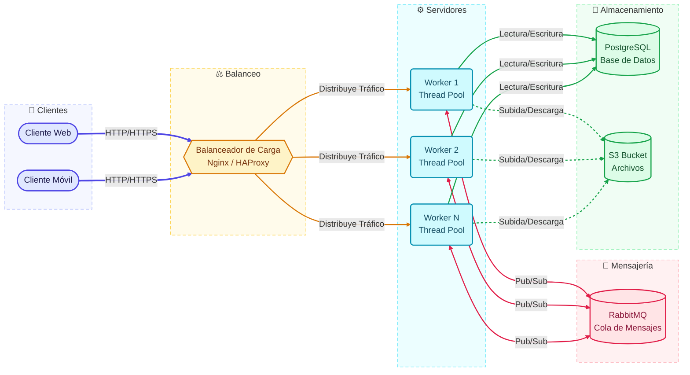
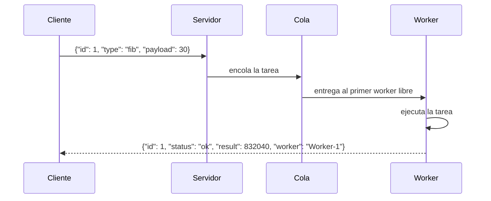

# PFO 3 - Rediseño como Sistema Distribuido (Cliente-Servidor) - PSR 3E

Implementación en Python de un sistema cliente-servidor en el que un **servidor** recibe tareas por **sockets TCP**, las encola y las distribuye a un grupo de **workers** que las procesan en paralelo. Un **cliente** envía las tareas y recibe los resultados.

Solo usa la librería estándar de Python, no hay dependencias que instalar.

## Arquitectura

El diseño completo del sistema distribuido es el siguiente. Las capas de **Clientes**, **Servidores (workers)** y **Mensajería (cola)** están implementadas en este proyecto; el balanceo se resuelve con una cola compartida y el almacenamiento queda como extensión futura (ver [Alcance](#alcance)).



### Cómo se implementó

| Componente del diagrama | En este proyecto |
|---|---|
| Clientes | `client.py`: se conecta por socket TCP, envía tareas y muestra los resultados. |
| Balanceador de carga | La **cola compartida**: cada worker libre toma la siguiente tarea, lo que reparte la carga de forma natural. |
| Cola de mensajes (RabbitMQ) | `queue.Queue` de la librería estándar, con tamaño máximo configurable (aplica *backpressure* cuando se llena). |
| Workers (Thread Pool) | Hilos (`threading.Thread`) que consumen tareas de la cola y devuelven el resultado al cliente que la envió. |

## Flujo de una tarea



## Estructura del proyecto

```
.
├── server.py   # Servidor: acepta conexiones, encola tareas y administra los workers
├── client.py   # Cliente: envía tareas y recibe resultados
└── README.md
```

## Requisitos

- Python 3.8 o superior
- Ninguna dependencia externa

## Uso

### 1. Iniciar el servidor

```bash
python server.py --workers 4
```

| Opción | Por defecto | Descripción |
|---|---|---|
| `--host` | `127.0.0.1` | Dirección donde escucha el servidor |
| `--port` | `9000` | Puerto TCP |
| `--workers` | `4` | Cantidad de workers |
| `--queue-size` | `1000` | Tamaño máximo de la cola |

Para detenerlo, `Ctrl+C`.

### 2. Ejecutar el cliente

```bash
# Set de tareas de demostración
python client.py

# Tareas propias (formato TIPO:PAYLOAD, se puede repetir -t)
python client.py -t fib:30 -t prime:97 -t upper:hola -t "sum:[1,2,3]" -t sleep:2
```

| Opción | Por defecto | Descripción |
|---|---|---|
| `--host` | `127.0.0.1` | Dirección del servidor |
| `--port` | `9000` | Puerto del servidor |
| `-t`, `--task` | set de demo | Tarea a enviar (`TIPO:PAYLOAD`) |
| `--timeout` | `30` | Segundos máximos de espera por los resultados |

El payload se interpreta como JSON si es posible (`30`, `[1,2,3]`); si no, como texto.

### Ejemplo de salida

```
Enviadas 11 tareas a 127.0.0.1:9000

[#1] fib:30                   -> 832040  (Worker-1, 0.00s total)
[#3] prime:97                 -> True  (Worker-1, 0.00s total)
[#6] upper:hola mundo         -> HOLA MUNDO  (Worker-1, 0.00s total)
[#10] fib:abc                 -> ERROR: invalid literal for int() with base 10: 'abc'  (Worker-1, 0.00s total)
[#8] sleep:1                  -> dormí 1.0s  (Worker-2, 1.00s total)
[#9] sleep:2                  -> dormí 2.0s  (Worker-3, 2.00s total)
```

Los resultados llegan en el orden en que los workers terminan, no en el de envío; por eso cada mensaje lleva un `id`.

## Tareas disponibles

| Tipo | Payload | Descripción |
|---|---|---|
| `fib` | entero `0-10000` | Número de Fibonacci |
| `prime` | entero | Indica si es primo |
| `sum` | lista de números | Suma los elementos |
| `upper` | texto | Convierte a mayúsculas |
| `reverse` | texto | Invierte el texto |
| `sleep` | segundos `0-10` | Simula trabajo pesado |

Para agregar una tarea nueva, se define una función en `server.py` y se registra en el diccionario `TASKS`.

## Protocolo

Mensajes JSON, uno por línea (`\n`), sobre TCP.

**Solicitud (cliente → servidor)**

```json
{"id": 1, "type": "fib", "payload": 30}
```

**Respuesta (servidor → cliente)**

```json
{"id": 1, "status": "ok", "result": 832040, "worker": "Worker-1", "elapsed": 0.0001}
```

```json
{"id": 10, "status": "error", "error": "tipo de tarea desconocido: 'inexistente'", "worker": "Worker-2", "elapsed": 0.0}
```

Si el servidor recibe un mensaje que no es JSON válido, responde con `status: "error"` y mantiene la conexión abierta.

## Decisiones de diseño

- **Un hilo por conexión de cliente:** el servidor atiende varios clientes a la vez.
- **Lock por conexión:** evita que dos workers mezclen sus respuestas al escribir en el mismo socket.
- **Cola con tamaño máximo:** si los clientes envían más rápido de lo que los workers procesan, el servidor frena la lectura en lugar de agotar la memoria.
- **Errores aislados:** una excepción dentro de una tarea se devuelve al cliente como error y no afecta al worker ni al servidor.

## Alcance

Implementado:

- Servidor que recibe tareas por socket y las distribuye a workers
- Cliente que envía tareas y recibe resultados
- Cola de tareas con balanceo natural entre workers
- Manejo de errores y de mensajes inválidos

Fuera de alcance (presentes en el diagrama como diseño objetivo):

- Persistencia en PostgreSQL y almacenamiento de archivos en S3
- Balanceador de carga externo (Nginx / HAProxy) y broker de mensajes dedicado (RabbitMQ)
- Workers como procesos independientes: al usar hilos, las tareas que consumen mucho CPU están limitadas por el GIL de Python
